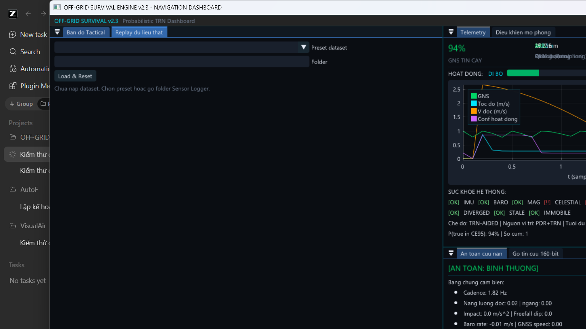
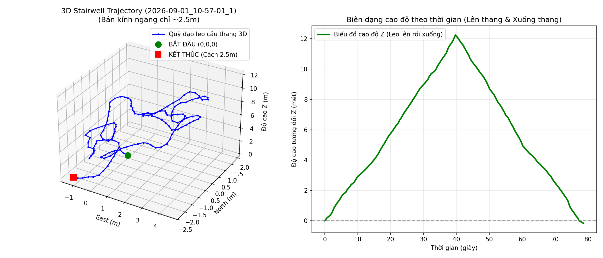
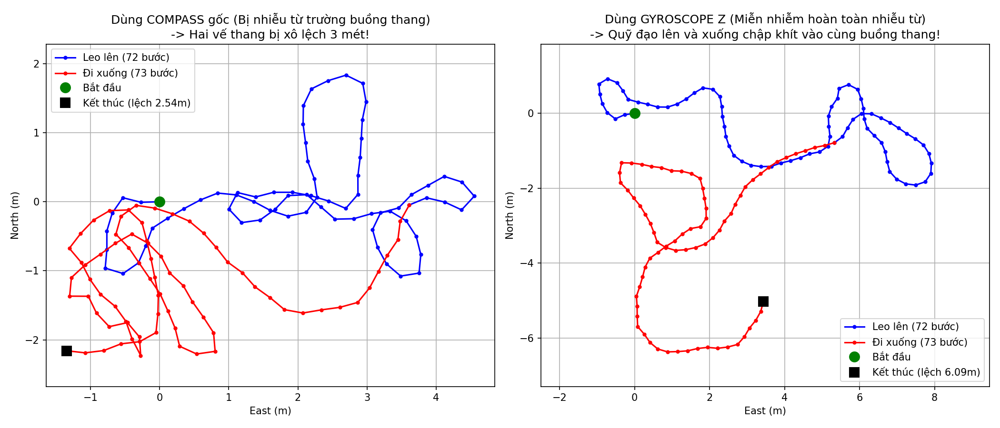
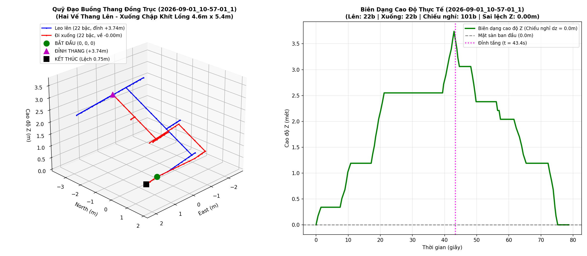

# Off-Grid Survival Engine

> **Probabilistic Offline Survival & Dead Reckoning Navigation Engine**  
> *Lõi định vị sinh tồn xác suất ngoại tuyến chuẩn C++20, kết hợp dung hợp cảm biến đa tần số (Sensor Fusion), khớp địa hình DEM, thiên văn học và khung thực nghiệm (Research Harness).*

[](https://en.wikipedia.org/wiki/C%2B%2B20)
[](https://cmake.org/)
[](LICENSE)
[]()
[]()

---

## Giới thiệu (Overview)

**Off-Grid Survival Engine** là hệ thống định vị và sinh tồn xác suất ngoại tuyến phân tán, được thiết kế hoạt động hoàn toàn độc lập trong môi trường **không có GPS** (rừng núi sâu, hầm ngầm, tòa nhà cao tầng, khu vực thiên tai hoặc bị chế áp điện tử).

Thay vì phụ thuộc vào một tọa độ ước lượng điểm duy nhất dễ bị trôi dạt (drift), động cơ duy trì một **đám mây phân phối đa giả thuyết (Multi-Hypothesis Particle Cloud)**. Hệ thống kết hợp kỹ thuật lọc bù sai số quán tính (3D ESKF), đếm bước chân thông minh (PDR), mô hình độ cao địa hình số (DEM), thiên văn học (Jean Meeus Ephemeris) và máy trạng thái cơ sinh học chuyển động (Biomechanical FSM) để liên tục hiệu chỉnh sai số tích lũy theo thời gian thực.

---

## Tính năng nổi bật (Key Features)

- **Zero-Allocation Hot Path:** Không cấp phát bộ nhớ động (`malloc`, `new`) trên chu trình thời gian thực 50Hz/100Hz; sử dụng buffer tĩnh và cấu trúc dữ liệu đã reserve sẵn.
- **3D Error-State Kalman Filter (ESKF):** Tích phân Quaternion động học 100Hz, cổng hấp dẫn bán tĩnh (Quasi-Static Gravity Gate), bù nghiêng la bàn (DCM Tilt Compensation) và cổng lọc nhiễu từ trường Chi-Square ($\chi^2$).
- **Dead Reckoning & PDR Đa Mô Hình:** Bộ lọc thông dải IIR Butterworth (0.5 – 3.0 Hz), thuật toán phát hiện bước thích ứng động, tích hợp các mô hình độ dài bước chân (Weinberg, Kim, Scarlett, Gaidamba).
- **Máy trạng thái sinh học (11 Motion Modes):** Tự động nhận diện trạng thái: *Đứng yên (Stationary), Đi bằng phẳng (Walking Flat), Chạy (Running), Lên/Xuống cầu thang (Stairs Ascent/Descent), Thang máy (Elevator), Thang cuốn (Escalator), Phương tiện (Vehicle), Ngã/Lăn lộn (Tumble/Fall).*
- **Khớp bản đồ địa hình số (Terrain-Referenced Navigation - TRN):** Parser file nhị phân DEM `.sdem` tối ưu đọc qua bộ nhớ chia sẻ / Memory-Mapped I/O, nội suy song tuyến (bilinear) và song bậc ba (bicubic).
- **Định vị thiên văn học (Astronomical Ephemeris):** Thuật toán Jean Meeus tính toán vị trí Mặt Trời / Mặt Trăng làm mốc phương vị tuyệt đối không từ tính.
- **Cứu nạn & Gói tin sinh tồn (Rescue Telemetry):** Đóng gói nhị phân siêu gọn (Compact Binary Rescue Packet), phát hiện ngã (Tumble Auditor) và cơ chế còi báo cứu nạn.
- **Dashboard trực quan & Web UI:** Giao diện máy tính Native (Dear ImGui v1.90.9 + ImPlot v0.16 + DirectX 11) kết hợp Web Server tích hợp phục vụ giao diện Web HUD thời gian thực (`http://localhost:8080`).

---

## Kiến trúc luồng dữ liệu (Data Pipeline Architecture)

```text
               [CẢM BIẾN PHẦN CỨNG]
     ┌──────────────┬──────────────┬──────────────┐
     │  IMU (100Hz) │  Baro (10Hz) │  Mag (20Hz)  │
     └──────┬───────┴──────┬───────┴──────┬───────┘
            │              │              │
            ▼              ▼              ▼
  ┌──────────────────────────────────────────────────────────┐
  │ [STAGE 1] INGESTION & INTEGRITY SANITIZER                │
  │ - NaN/Inf Sanitizer, Giới hạn vật lý |a| < 50 m/s^2      │
  │ - Loại bỏ nhiễu từ trường cực đoan (|m| > 200 uT)        │
  └─────────────────────────┬────────────────────────────────┘
                            │ SensorFrame chuẩn hóa
                            ▼
  ┌──────────────────────────────────────────────────────────┐
  │ [STAGE 2] FAST LOOP: ESKF 3D ATTITUDE (100 Hz)           │
  │ - Tích phân Quaternion động học: q_(k+1) = q_k ⊗ dq(ω)   │
  │ - Lan truyền hiệp phương sai: P = F P F^T + Q            │
  │ - Cổng hấp dẫn Quasi-Static & Chi-Square Mag Gating      │
  │ - Xuất: Yaw (ψ), Roll (φ), Pitch (θ), a_v, a_h           │
  └─────────────┬───────────────────────────┬────────────────┘
                │                           │
                │ a_v (100Hz)               │ Attitude, Yaw (100Hz)
                ▼                           ▼
  ┌───────────────────────────┐   ┌──────────────────────────┐
  │ [STAGE 3A] STEP DETECTION │   │ [STAGE 3B] INSTANTANEOUS │
  │ - IIR Butterworth Bandpass│   │ VELOCITY ESTIMATOR       │
  │ - Dynamic Peak/Valley     │   │ - 1-Euro Adaptive Filter │
  │ - StepEvent (1 - 2 Hz)    │   │ - ZUPT Lock khi đứng yên │
  └─────────────┬─────────────┘   └─────────────┬────────────┘
                │                               │
                ▼                               │
  ┌─────────────────────────────────────────┐   │
  │ [STAGE 4] BIOMECHANICAL CLASSIFIER & FSM│   │
  │ - Nhận diện 11 hoạt động di chuyển      │   │
  │ - Phân biệt bậc cầu thang / chiếu nghỉ  │   │
  └─────────────┬───────────────────────────┘   │
                │ MotionActivity & StepLength   │
                ▼                               ▼
  ┌──────────────────────────────────────────────────────────┐
  │ [STAGE 5] MULTI-HYPOTHESIS PARTICLE FILTER & TRN         │
  │ - Lan truyền hạt theo vận tốc & hướng đi                 │
  │ - Cập nhật trọng số theo độ cao DEM & Khí áp kế (Baro)   │
  │ - Tái lấy mẫu có hệ thống (Systematic Resampling)        │
  │ - Cụm xác suất GMM / DBSCAN (Multi-Modal Distribution)   │
  └─────────────────────────┬────────────────────────────────┘
                            │
                            ▼
  ┌──────────────────────────────────────────────────────────┐
  │ [STAGE 6] TELEMETRY, GUI & RESCUE PROTOCOL               │
  │ - Tính toán Elip sai số CE50 / CE95                      │
  │ - Native ImGui Dashboard + Embedded Web Server (Port 8080)│
  │ - Đóng gói Compact Rescue Beacon qua LoRa / Mesh         │
  └──────────────────────────────────────────────────────────┘
```

---

## Cấu trúc thư mục (Monorepo Layout)

```text
OFF-GRID-SURVIVAL/
├── CMakeLists.txt                 # File cấu hình tổng CMake C++20
├── LICENSE                        # MIT License
├── README.md                      # Tài liệu tổng quan dự án
│
├── core/                          # [MODULE 1] LÕI THUẬT TOÁN (C++20 Thuần)
│   ├── include/survival_core/
│   │   ├── c_api/                 # Lock-free C API cho Android JNI / Cross-platform
│   │   ├── comms/                 # Đóng gói giao thức cứu nạn nhị phân
│   │   ├── environment/           # Parser DEM (.sdem) & Thiên văn Jean Meeus
│   │   ├── estimators/            # 3D ESKF, Particle Filter, GMM, Nhận diện cầu thang
│   │   ├── integrity/             # Cholesky Guard, NaN/Inf Sanitizer, Giám sát NEES/NIS
│   │   ├── kinematics/            # PDR, Bước chân, Mô hình sải chân, Quaternions
│   │   └── safety/                # Fall Detection, Tumble Auditor, Resource Governor
│   └── src/
│
├── harness/                       # [MODULE 2] KHUNG THỰC NGHIỆM & BENCHMARK
│   ├── include/survival_harness/
│   │   ├── DataPlayer.hpp         # Đọc sensor log, đồng bộ thời gian (Time-sync)
│   │   ├── FailureInjector.hpp    # Tiêm lỗi giả lập (nhiễu từ trường, trôi áp kế)
│   │   └── MetricsCollector.hpp   # Đo đạc thống kê (CE50, CE95, NEES, NIS)
│   └── src/
│
├── desktop/                       # [MODULE 3] GIAO DIỆN NGƯỜI DÙNG & HUD
│   ├── src/                       # Ứng dụng Desktop Native (Dear ImGui, ImPlot, DX11)
│   └── web/                       # Giao diện Web Dashboard thời gian thực (HTML5/CSS3/JS)
│
├── platform/                      # [MODULE 4] PHẦN CỨNG & CẢM BIẾN TRỪU TƯỢNG (HAL)
│   ├── include/survival_platform/
│   └── src/
│
├── tests/                         # [MODULE 5] SUITE KIỂM THỬ GOOGLETEST
│   └── (47 file kiểm thử bao phủ toàn diện thuật toán, số học và hồi quy dữ liệu thật)
│
├── tools/                         # [MODULE 6] CÔNG CỤ TÁI HIỆN & PHÂN TÍCH
│   ├── replay_evaluation.cpp      # Công cụ đánh giá replay dữ liệu cảm biến
│   └── debug_stairs.cpp           # Công cụ chẩn đoán thuật toán cầu thang 3D
│
├── scripts/                       # [MODULE 7] SCRIPT PYTHON XỬ LÝ DỮ LIỆU
│   ├── batch_motionsense_eval.py  # Chạy benchmark trên tập MotionSense
│   ├── reconstruct_true_3d_stairs.py # Tái tạo quỹ đạo 3D thực địa
│   └── solve_stairs_physics_truth.py # Giải phương trình vật lý chuyển động
│
├── testdata/                      # Tập dữ liệu kiểm thử & mẫu cảm biến (MotionSense)
└── docs/                          # Tài liệu kỹ thuật chi tiết & Báo cáo thực nghiệm
```

---

## Hướng dẫn cài đặt & Biên dịch (Build Instructions)

### Yêu cầu hệ thống
- **Trình biên dịch C++20:**
  - Windows: MSVC 2019/2022 (v142+ hoặc v143+)
  - Linux: GCC 11+ hoặc Clang 13+
- **CMake:** Phiên bản `>= 3.20`
- **Bộ sinh mã xây dựng:** Ninja (khuyến nghị) hoặc Make / Visual Studio Solution
- *Tất cả thư viện phụ thuộc (Eigen 3.4.0, GoogleTest 1.14.0, Dear ImGui, ImPlot, cpp-httplib) đều được quản lý tự động tải qua CMake `FetchContent`.*

### Các bước biên dịch

```bash
# 1. Clone kho lưu trữ
git clone https://github.com/Stufusic/OFF-GRID-SURVIVAL.git
cd OFF-GRID-SURVIVAL

# 2. Tạo thư mục build và cấu hình với CMake
cmake -B build -G "Ninja" -DCMAKE_BUILD_TYPE=Release

# 3. Biên dịch toàn bộ dự án
cmake --build build --config Release
```

*(Nếu sử dụng Visual Studio Generator trên Windows: `cmake -B build && cmake --build build --config Release`)*

---

## Chạy Kiểm thử & Khung thực nghiệm (Testing & Evaluation)

### 1. Chạy toàn bộ Unit Tests (GoogleTest)

Toàn bộ 47 test suites với hơn 100 bài kiểm thử bao phủ tính đúng đắn số học, an toàn ma trận và mô hình chuyển động:

```bash
# Chạy trực tiếp qua CTest
cd build
ctest --output-on-failure

# Hoặc chạy binary kiểm thử
./bin/unit_tests
```

### 2. Khởi chạy Desktop Navigation HUD & Web Server

```bash
# Chạy ứng dụng Desktop Native
./build/desktop/survival_desktop_gui.exe
```

Ứng dụng sẽ đồng thời khởi chạy **Embedded HTTP Server** tại cổng `8080`. Bạn có thể mở trình duyệt và truy cập:
`http://localhost:8080` để theo dõi giao diện Web Dashboard thời gian thực.

### 3. Chạy công cụ Replay & Benchmark dữ liệu cảm biến

```bash
./build/tools/replay_evaluation.exe
```

---

## Hình ảnh minh họa (Screenshots & Visuals)

| Giao diện Replay & Dashboard HUD | Quỹ đạo 3D Cầu thang thực tế |
|:---:|:---:|
|  |  |

| Phân tích Phương vị La bàn vs Gyro | Tái cấu trúc chuyển động trục đồng tâm |
|:---:|:---:|
|  |  |

---

## Quy chuẩn lập trình & Bất biến an toàn (Safety Invariants)

Mã nguồn tuân thủ nghiêm ngặt các quy tắc an toàn số học:

1. **Hot-Path Zero-Allocation:** Không `new`, `malloc`, reallocation trong vòng lặp ước lượng trạng thái.
2. **Bảo toàn số học:** Mọi ma trận hiệp phương sai $\mathbf{P}$ sau bước cập nhật Kalman bắt buộc được ép đối xứng: $\mathbf{P} = 0.5(\mathbf{P} + \mathbf{P}^T)$. Sử dụng Cholesky Guard ngăn ngừa giá trị kỳ dị.
3. **Chuẩn hóa góc:** Góc phương vị và sai số chuẩn hóa về $[-\pi, \pi]$ bằng `atan2(sin, cos)`.
4. **NaN/Inf Sanitizer:** Tuyệt đối không để dữ liệu cảm biến lỗi hoặc không xác định thâm nhập vào các bộ lọc.

---

## Bản quyền (License)

Dự án được phân phối dưới giấy phép [MIT License](LICENSE).

Bản quyền (c) 2026 Stufusic. Toàn quyền được bảo lưu.
